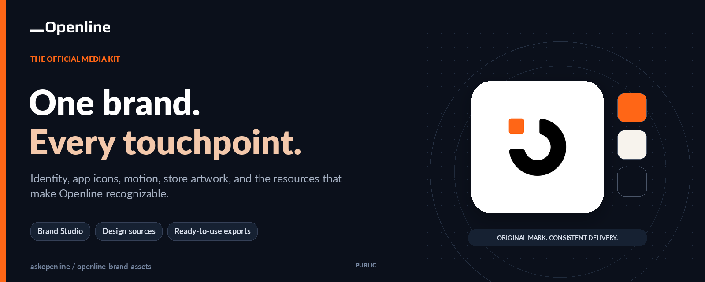
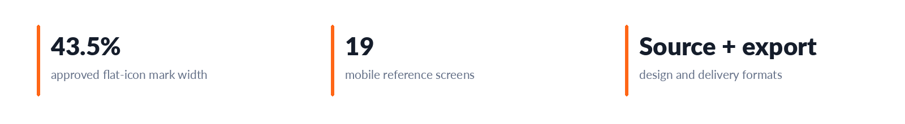
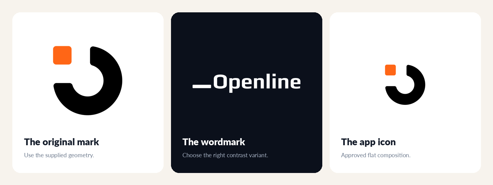
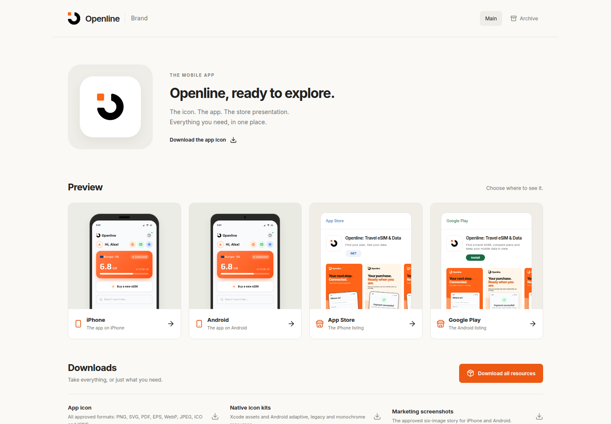
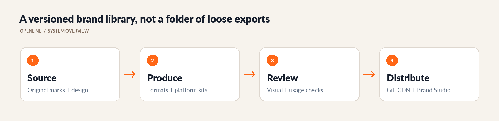

# Openline Brand Assets

<!-- CUP-OF-NEWS-STYLE -->
<div align="center">

[](https://openline.com)
[](https://github.com/askopenline/openline-brand-assets)
[](https://github.com/askopenline/openline-brand-assets/releases)
[](#brand-studio)




**Identity, app icons, motion, store artwork, and the resources that make Openline recognizable.**

[Company website](https://openline.com) · [Project overview](https://openline-brand.fly.dev) · [Release history](https://github.com/askopenline/openline-brand-assets/releases) · [Contribution guide](.github/OPENLINE-CONTRIBUTING.md)

</div>

---

The official Openline media kit and working brand library. Logos, app icons, motion, store artwork, design sources, email resources, and shared interface assets are organized here so company teams and approved partners can work from one recognizable visual identity.

<p align="center">
  <a href="https://openline-brand.fly.dev"><strong>Open Brand Studio</strong></a> ·
  <a href="#asset-library">Browse the library</a> ·
  <a href="#app-icon-system">App icon kit</a> ·
  <a href="#using-and-embedding-assets">Use the assets</a> ·
  <a href="https://github.com/askopenline/openline-brand-assets/releases">Releases</a>
</p>



---

## Asset library

The library keeps original artwork, delivery formats, implementation references, and review history together. Choose the asset family that matches your use case rather than copying an arbitrary image from an older screenshot.

| Collection | What is inside | Start here |
| --- | --- | --- |
| Identity | The Openline symbol, wordmark, and light/dark variants | [`logo/`](logo/), [`wordmark/`](wordmark/) |
| Social | Profile and social-format resources | [`social/`](social/) |
| Motion | Approved animated brand exports | [`animation/`](animation/) |
| App icons | Final composition, raster/vector formats, and native integration kits | [Final app icon](app-icons/final/README.md) |
| Brand Studio | Device and store previews, marketing artwork, copy drafts, and download packages | [Studio guide](launch-studio/README.md) |
| Mobile UI | Buildable screen references and delivery context | [Mobile resources](mobile/README.md) |
| Figma | Design-source links, exports, and supplied snapshots | [Figma references](figma/README.md) |
| Email | Transactional templates, letterhead, components, and staff signatures | [Email resources](email/README.md) |
| Shared web UI | Styles and integration examples for Openline interfaces | [Web styles](web/README.md) |
| Payment methods | Third-party identification marks and attribution | [Payment marks](payment-methods/README.md) |
| Virtual office | Interface concepts, launcher references, and screenshots | [Virtual-office previews](workadventure/README.md) |

---

## A recognizable visual system



The original mark and wordmark are the starting point. Openline orange, clear contrast, deliberate whitespace, and consistent asset variants carry that identity across product, marketing, documentation, and operational surfaces.

- **Primary orange:** `#FF6616`.
- **Artwork:** Use the supplied geometry and proportions rather than redrawing or stretching a mark.
- **Contrast:** Choose the appropriate light or dark variant and preserve clear space.
- **Product typography:** Follow the relevant product or asset-family specification; a web stylesheet is not automatically the typography contract for every surface.
- **Versions:** Pin reviewed assets when a consumer must not change unexpectedly.

### Brand motion

The motion library includes the original loading loop alongside horizontal,
square, and favicon-oriented exports. Use the supplied animation rather than
inventing a new movement for the mark.

<p align="center">
  
</p>

---

## Brand Studio

Brand Studio makes the launch materials explorable instead of leaving them buried in folders. Its Main view presents the final icon and device/store previews, while Archive retains the broader review workbench and earlier comparisons.



| Area | Purpose |
| --- | --- |
| Final icon | Inspect the approved composition and download prepared formats |
| Device previews | Compare the icon and app presentation on iPhone and Android reference shells |
| Store presentation | Review marketing artwork separately from platform submission drafts |
| Copy and checklists | Work through listing copy and readiness questions |
| Workspace export | Save review state as JSON and restore it later |
| Prepared downloads | Share reviewed baseline packages without confusing them with unsaved edits |

Browser previews are visual references, not native-device or store-approval evidence. The [studio guide](launch-studio/README.md) links the platform-specific readiness and copy-review records.

### Run Brand Studio locally

```sh
git clone https://github.com/askopenline/openline-brand-assets.git
cd openline-brand-assets/launch-studio
npm ci
npm run dev
```

For a production bundle, run `npm run build`, then inspect it with `npm run preview`. Use the [hosting guide](launch-studio/hosting/README.md) for the existing deployment rather than assuming a Git push is itself a deployment command.

---

## App icon system

The approved flat composition places the original Openline mark at **43.5% visible width** inside an unchanged white square. Start with [`app-icons/final/`](app-icons/final/README.md); earlier deliveries remain available for history and comparison.

| Resource | Intended use |
| --- | --- |
| [Final package](app-icons/final/README.md) | Canonical visual composition and overview |
| [Export formats](app-icons/final/formats/README.md) | PNG, SVG, vector PDF, TIFF, WebP, and design-facing formats |
| [Native kit](app-icons/final/native/README.md) | Apple and Android integration resources |
| [Studio icon package](launch-studio/icon-package/README.md) | Packaging and native-acceptance notes |

Visual approval and native acceptance are different milestones. Validate actual signed builds, masks, launchers, and store requirements before submission; an SVG/PDF export is not a native Illustrator document, and source layers are not a compiled Icon Composer file.

---

## Using and embedding assets

The company repository is the source for current Openline asset URLs. Use a reviewed full commit SHA or verified tag for a stable integration; use `main` only when a consumer intentionally follows ongoing changes.

```text
# Original company mark
https://raw.githubusercontent.com/askopenline/openline-brand-assets/main/openline-mark-512.png

# Shared interface stylesheet
https://cdn.jsdelivr.net/gh/askopenline/openline-brand-assets@main/web/openline-ui.css

# A specific payment-method asset
https://raw.githubusercontent.com/askopenline/openline-brand-assets/main/payment-methods/svg/visa.svg
```

Raw GitHub URLs are for files, not a substitute for a configured HTML application host. Check file integrity, caching, MIME types, relative paths, and the consuming interface when changing an asset URL.

---

## Source-to-release workflow



1. Preserve the original artwork and record the provenance of new design deliveries.
2. Prepare the required formats without changing approved proportions or composition.
3. Review dimensions, transparency, contrast, text fit, and the intended consumer.
4. Update the relevant guide, previews, generated packages, and download links together.
5. Publish a reviewed company release and deliberately update consumers that need it.

The [company changelog](OPENLINE-CHANGELOG.md) and [GitHub releases](https://github.com/askopenline/openline-brand-assets/releases) provide version context. For a change request or missing format, use [repository issues](https://github.com/askopenline/openline-brand-assets/issues) and the [contribution guide](.github/OPENLINE-CONTRIBUTING.md).

---

## Usage and permissions

The library is public so Openline can be represented accurately by its teams, journalists, partners, integrators, and customers. Public access is not a blanket open-source license for the brand or a transfer of third-party rights.

- Use Openline brand assets as supplied, without recoloring, rotation, distortion, or unapproved effects.
- Do not imply a partnership, endorsement, or affiliation that does not exist.
- Do not use the assets for products, services, or content that compete with or disparage Openline.
- Request approval for co-branding, merchandise, paid placement, or large-scale physical signage.
- Preserve file-level licenses and attribution for fonts, payment marks, software, and reference material.

Contact [ask@openline.com](mailto:ask@openline.com) for brand permissions, press, or partnerships. Sensitive reports should follow the [company security guide](.github/OPENLINE-SECURITY.md).

---

## Design and technology choices

### Source and delivery together

Keeping original artwork alongside prepared exports makes it easier to reproduce formats and avoid tracing a low-resolution derivative.

### Explore rather than guess

Brand Studio gives reviewers an interactive way to compare actual assets and platform presentations while keeping marketing artwork distinct from submission readiness.

### Versioned distribution

Commit and release references give an integration a stable asset identity. That is safer than assuming every consumer should follow a changing branch.

---

## Part of Openline

Openline maintains the company-created identity and resources in this repository through its official [askopenline account](https://github.com/askopenline). Payment providers, upstream software authors, font designers, and other third parties retain ownership of their respective work.

Explore the company at [openline.com](https://openline.com), or continue into the [design-review workspace](https://github.com/askopenline/openline-anims-review), [knowledge base](https://github.com/askopenline/openline-kb), [compatibility explorer](https://github.com/askopenline/openline-check), and [OS visual system](https://github.com/askopenline/openline-notion).
